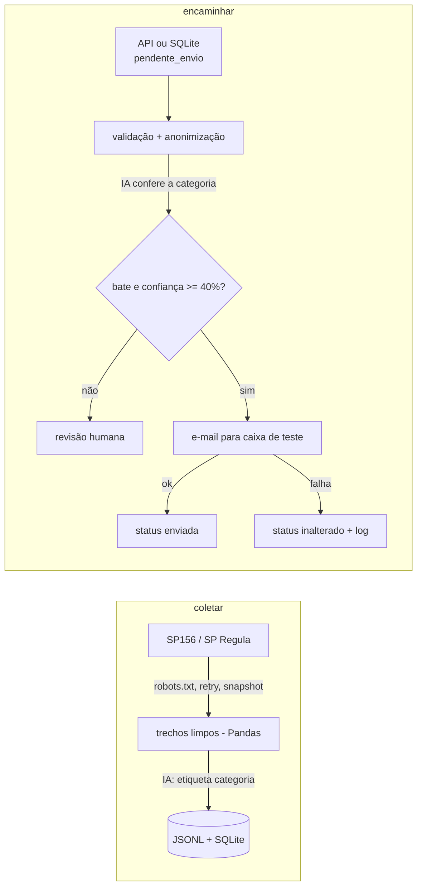

# Quem Resolve? · Módulo de automação (RPA + IA)

**FIAP | Tecnólogo em Inteligência Artificial | Global Solution 2026.2 | AI for Robotic Process Automation**

## Integrantes

| Nome | RM |
|---|---|
| Matheus Mikio Tutume Lourenço | 561864 |
| Ian Nobres Azevedo | 561861 |

## O problema

Em São Paulo, o cidadão que encontra um buraco, um poste apagado, um fio caído, um bueiro entupido ou lixo acumulado raramente sabe **quem resolve**. Pode ser a subprefeitura, a Enel, a Sabesp, a Comgás, a CET, a operadora de telecom, o dono do imóvel ou a Defesa Civil. O pedido vai para o canal errado, volta ou fica parado. Do lado da gestão, o SP156 recebe mais de 1 milhão de solicitações por ano, e parte delas está fora da competência da Prefeitura, mal descrita ou duplicada.

**Público:** moradores de São Paulo que reportam problemas de zeladoria e limpeza urbana, e os órgãos que recebem esses pedidos.

## Como este módulo se encaixa no "Quem Resolve?"

O **Quem Resolve?** é um roteador: o cidadão reporta o problema no app, a IA sugere a categoria, o cidadão confirma, e o sistema diz quem é o responsável e encaminha a ocorrência. Violência e emergências **não** são roteadas: um guardrail de outro módulo cuida delas. Este repositório é o **módulo de RPA** (requisitos RF30 a RF35 do PRD):

| Etapa | Requisito | O que o robô faz |
|---|---|---|
| `coletar` | RF30, RF31, RF32 | Raspa a Carta de Serviços do SP156 e o FAQ de iluminação pública do SP Regula, limpa os textos com Pandas, quebra em trechos para o **assistente RAG** e grava em `data/base_conhecimento.jsonl` e na tabela SQL `documento_base`. Espelha a base "quem resolve o quê" no SQL |
| `gerar` | RF34 | Gera ocorrências simuladas realistas (texto informal, erros de digitação, dados pessoais **fictícios**) no formato de `CONTRATOS.md` |
| `treinar` | IA | Treina o classificador TF-IDF + Regressão Logística nas 20 categorias |
| `encaminhar` | RF33 | Lê as ocorrências `pendente_envio` (pela API do produto ou, se ela estiver fora, pelo SQLite local), anonimiza, confere a categoria com a IA, consulta a base quem-resolve, envia o e-mail e marca como `enviada`. Se falhar, o status não muda |

As 20 categorias (RF35 incluído) e os responsáveis estão em [`data/base_quem_resolve.json`](data/base_quem_resolve.json). A ocorrência segue `CONTRATOS.md` v0.1, seção E: `GET /ocorrencias?status=pendente_envio` e `PATCH /ocorrencias/{id}/status`.

> **A alinhar com a dupla:** o `CONTRATOS.md` v0.1 usa `buraco` e `fio_telecom` como exemplos de id de categoria. Este módulo usa os ids da lista de 20 categorias (`buraco_via`, `fiacao_telecom_solta`...). Como o id não pode mudar depois de criado, o `CONTRATOS.md` precisa ser atualizado com a lista definitiva. O robô manda para a revisão humana qualquer ocorrência com categoria fora da base (é um dos casos de teste).



## Como executar

Requisito: Python 3.10 ou superior.

```bash
pip install -r requirements.txt
```

**1. Suba o servidor SMTP local de teste** num terminal separado e deixe-o aberto. Ele mostra cada e-mail recebido e nada sai da máquina:

```bash
python -m aiosmtpd -n -l localhost:1025
```

**2. Rode o robô de ponta a ponta** em outro terminal (ponto de entrada único):

```bash
python main.py tudo
```

`tudo` executa `gerar` → `treinar` → `coletar` → `encaminhar`. Cada etapa também pode rodar sozinha (`python main.py coletar`, por exemplo). Se você não quiser abrir o segundo terminal, use o SMTP embutido, que grava os e-mails em `output/caixa_teste/`:

```bash
python main.py tudo --smtp-local
```

**3. Gere as evidências:**

```bash
python avaliar.py
```

```bash
python demo_falhas.py
```

`avaliar.py` gera [`docs/RESULTADOS_AVALIACAO.md`](docs/RESULTADOS_AVALIACAO.md) e `demo_falhas.py` gera [`docs/EVIDENCIAS_FALHAS.md`](docs/EVIDENCIAS_FALHAS.md). Os dois rodam em pastas isoladas (`avaliacao_execucao/`, `demo_falhas_execucao/`) e usam portas próprias (1026 e 1027), sem mexer nos dados do robô principal.

| Opção | Efeito |
|---|---|
| `--offline` | `coletar` usa só os snapshots de `data/snapshots/`, sem acessar a internet |
| `--smtp-local` | sobe um SMTP de teste embutido em `localhost:1025` durante a execução |

**Para recomeçar do zero**, apague `state/`, `output/`, `logs/`, `modelos/` e `data/quem_resolve.db`. Rodar de novo **sem** apagar não reenvia nada (idempotência): `gerar` não duplica ocorrências e `encaminhar` não reenvia e-mails.

**Testar o caminho "via API"** sem a API real (API simulada no formato do contrato):

```bash
python -m src.mock_api
```

Depois, em outro terminal, coloque `API_BASE_URL=http://127.0.0.1:8156` no `.env` e rode `python main.py encaminhar`.

## Como configurar as chaves

Nenhuma chave é obrigatória: o padrão (SMTP local e SQLite) funciona sem credenciais. Tudo o que é configurável ou sensível fica em variáveis de ambiente, lidas por [`src/config.py`](src/config.py):

```bash
cp .env.example .env
```

| Variável | Para quê |
|---|---|
| `API_BASE_URL`, `API_TOKEN` | API do Quem Resolve?. Vazio = usa o SQLite local |
| `SMTP_HOST`, `SMTP_PORTA`, `SMTP_USUARIO`, `SMTP_SENHA`, `SMTP_STARTTLS` | servidor de e-mail. Opcional: Mailtrap ou Ethereal (o exemplo está no `.env.example`) |
| `DOMINIOS_DESTINO_PERMITIDOS` | trava de segurança: o robô só envia para estes domínios (padrão `caixa-teste.local`) |
| `LIMIAR_CONFIANCA`, `TENTATIVAS`, `BACKOFF_SEGUNDOS`, `TIMEOUT_HTTP`... | ajustes do robô |

O `.env` está no `.gitignore` e **nunca** vai para o repositório. Os destinatários são sempre fictícios (`enel@caixa-teste.local`, `sabesp@caixa-teste.local`...), nunca e-mails reais de órgãos.

## Estrutura de pastas

```
main.py                    ponto de entrada (subcomandos tudo|gerar|treinar|coletar|encaminhar)
gerar_dados.py             RF34: dados sintéticos (treino, teste rotulado, ocorrências + gabarito)
avaliar.py                 métricas -> docs/RESULTADOS_AVALIACAO.md (+ matriz_confusao.png)
demo_falhas.py             8 falhas provocadas -> docs/EVIDENCIAS_FALHAS.md
src/
  config.py                configuração via .env
  logger.py                log em arquivo e na tela
  resiliencia.py           retry com espera exponencial + circuit breaker
  coleta.py                scraping (robots.txt, User-Agent, atraso, snapshots)
  etl.py                   limpeza, chunks, etiquetagem e carga (Pandas, JSONL, SQL)
  db.py                    esquema SQLite (espelha o modelo de dados do PRD)
  base_quem_resolve.py     carrega e valida a base "quem resolve o quê"
  classificador.py         TF-IDF + Regressão Logística
  anonimizacao.py          mascaramento de CPF, telefone, e-mail e nome
  validacao.py             validação da ocorrência (contrato)
  repositorio.py           API (GET/PATCH) com reserva em SQLite
  email_envio.py           montagem e envio do e-mail (smtplib) + trava de domínio
  encaminhador.py          RF33: decide, envia, marca status, revisão humana, idempotência
  relatorio.py             relatório de execução (.md/.json)
  smtp_local.py            SMTP de teste embutido (aiosmtpd)
  mock_api.py              API simulada no formato de CONTRATOS.md
data/
  base_quem_resolve.json   20 categorias, responsáveis, fonte_url e status de validação
  fontes.json              páginas oficiais coletadas
  snapshots/               HTML salvo de cada fonte (caminho seguro quando o site falha)
  amostra_docs_rotulada.csv  30 trechos raspados com rótulo manual
  treino.csv, teste_rotulado.csv, gabarito_ocorrencias.csv   (gerados)
  base_conhecimento.jsonl  trechos para o RAG (gerado)
docs/                      quadro de temas, resultados, evidências de falhas, ética e ODS
output/                    relatórios, e-mails enviados (.eml), revisao_humana.csv (gerado)
logs/, state/, modelos/    log, registro de idempotência, modelo treinado (gerados)
```

## Entregáveis do enunciado

| Entregável | Onde está |
|---|---|
| Código do protótipo | `main.py` + `src/` |
| README | este arquivo |
| Quadro de temas (7 temas) | [`docs/QUADRO_DE_TEMAS.md`](docs/QUADRO_DE_TEMAS.md) |
| Evidências de validação | [`docs/RESULTADOS_AVALIACAO.md`](docs/RESULTADOS_AVALIACAO.md) e [`docs/EVIDENCIAS_FALHAS.md`](docs/EVIDENCIAS_FALHAS.md) |
| Proteção de dados, ética e ODS | [`docs/ETICA_ODS.md`](docs/ETICA_ODS.md) |

## Resultados medidos (dados sintéticos; detalhes em `docs/`)

Execução do zero em 10/11/2026:

- **Coleta:** 11 de 11 páginas oficiais coletadas online, resultando em 98 trechos para o RAG. O SP156 não publica robots.txt (HTTP 404) e o robots.txt da prefeitura.sp.gov.br não tem restrições.
- **Classificador** (300 frases de teste, 20 categorias, modelos de frase diferentes dos de treino): **acurácia de 84,7%** (254/300), F1 macro de 0,83. As piores categorias são `arvore_poda_queda` (recall de 0,13, confundida com `arvore_sobre_fiacao`), `alagamento` (0,53) e `poste_danificado` (0,60). Com o limiar de 40%, 82,7% dos casos ficam acima do limiar, com 87,9% de acerto.
- **Encaminhamento ponta a ponta** (80 ocorrências, via API simulada):
  - **0 envios errados**, porque as 10 ocorrências com categoria errada e as 6 inválidas foram todas barradas na revisão humana;
  - 40 das 60 válidas foram enviadas automaticamente (66,7%), **40/40 para o responsável correto**; as outras 20 foram para revisão por divergência ou confiança baixa da IA;
  - as 4 já enviadas foram ignoradas;
  - a reexecução enviou 0 e-mails.
- **Anonimização:** 260/260 dados pessoais fictícios mascarados (100%) e 0 dados pessoais nos e-mails enviados.
- **Etiquetagem dos trechos raspados:** 25/30 corretos (83,3%) na amostra rotulada. Os rótulos ainda são um rascunho a conferir.
- **Falhas:** 8 cenários provocados (site fora, snapshot ausente, arquivos e estado corrompidos, base corrompida, dados inválidos, API fora, SMTP fora, reexecução com falha no PATCH). Em todos o robô registrou no log, seguiu um caminho seguro e terminou a execução.

## Limites conhecidos

- **Dados sintéticos.** Com texto real a acurácia tende a ser menor. O modelo deve ser retreinado com ocorrências reais anonimizadas.
- **Automação conservadora:** 1 em cada 3 ocorrências corretas vai para a revisão humana. É o preço de não enviar nada para o órgão errado. O limiar pode ser ajustado em `.env` (a troca está medida em `RESULTADOS_AVALIACAO.md`).
- **Fontes curadas.** A busca e as listas do SP156 dependem de JavaScript, então a coleta usa URLs de serviço curadas em `data/fontes.json`. Se o site mudar o HTML, a extração falha de forma controlada e o robô usa o snapshot.
- **Base sem validação oficial completa.** 12 das 20 regras da base estão "a validar" (sem `fonte_url` oficial).
- **Anonimização por regras.** Não detecta nome solto, sem gatilho como "meu nome é".
