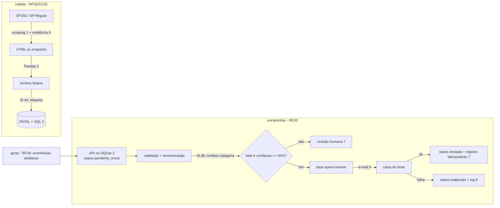

# Quadro de temas da disciplina

O módulo de RPA do **Quem Resolve?** usa **7 temas** da disciplina (o mínimo exigido é 3). Cada tema faz uma parte do trabalho: se fosse removido, o robô deixaria de fazer essa parte.

| # | Tema | Onde está no fluxo | O que resolve | Por que foi escolhido |
|---|---|---|---|---|
| 1 | **Web scraping responsável** (requests + BeautifulSoup) | `src/coleta.py`, etapa `coletar` (RF30). Lê 9 páginas da Carta de Serviços do SP156 e 2 páginas do SP Regula sobre iluminação pública, listadas em `data/fontes.json` | Traz para a base do assistente o texto oficial sobre quem resolve cada problema, prazos e canais, sem copiar à mão | As regras de "quem resolve" estão espalhadas em páginas públicas da Prefeitura. Coletar à mão não escala e desatualiza. O robô respeita o robots.txt, se identifica no User-Agent, espera entre requisições e usa snapshots quando o site falha |
| 2 | **Pandas / ETL** | `src/etl.py`, etapa `coletar` (RF31) | Limpa o texto (caracteres invisíveis, ruído de menu, espaços), remove duplicatas e quebra em trechos de até 700 caracteres prontos para o RAG | O HTML raspado vem sujo e em blocos de tamanhos variados. O RAG precisa de trechos limpos, curtos e com metadados (fonte, seção, categoria) |
| 3 | **SQL** (SQLite) | `src/db.py`. Tabelas `categoria`, `responsavel`, `regra_roteamento` (RF32), `documento_base` (trechos do RAG) e `ocorrencia` | Guarda a base "quem resolve o quê" e os trechos num banco consultável. É também a reserva das ocorrências quando a API do produto está fora | Espelha o modelo de dados do PRD (seção 10), então os dados migram para o Postgres/Supabase do produto sem redesenho |
| 4 | **NLP e Machine Learning** (TF-IDF de palavras e de caracteres + Regressão Logística) | `src/classificador.py`. Usado em dois pontos: (a) `etl.etiquetar` dá a categoria de cada trecho raspado; (b) `encaminhador` confere se a descrição da ocorrência bate com a categoria escolhida | (a) O RAG pode filtrar os trechos por categoria. (b) Evita mandar e-mail para o órgão errado quando o cidadão confirmou uma categoria errada | É leve, gratuito, roda offline e não depende de LLM (que é opcional no enunciado). Os n-gramas de caracteres toleram erros de digitação ("bueru", "lampada") |
| 5 | **Automação de e-mail** (smtplib + EmailMessage) | `src/email_envio.py`, etapa `encaminhar` (RF33) | Monta e envia o encaminhamento da ocorrência ao responsável, com protocolo, categoria, prioridade, localização e a descrição já anonimizada | O PRD define o envio como simulado por e-mail para caixas de teste. O padrão é um SMTP local sem credenciais, e uma trava só permite os domínios `caixa-teste.local` |
| 6 | **Resiliência** (timeout, retry com espera exponencial, circuit breaker, fallback) | `src/resiliencia.py`, usado pelo scraping, pela API e pelo SMTP. Fallbacks: snapshot HTML (site fora), SQLite (API fora), status mantido (SMTP fora) | Nenhuma falha previsível interrompe a execução. Cada etapa de `main.py tudo` trata as próprias falhas e a próxima continua | Sites públicos caem e mudam, a API do produto ainda está em construção e o SMTP pode estar desligado. Ver [`EVIDENCIAS_FALHAS.md`](EVIDENCIAS_FALHAS.md) |
| 7 | **Human-in-the-loop e idempotência** | `src/encaminhador.py`: fila `output/revisao_humana.csv` e registro `state/enviados.json` (escrita atômica) | Casos inválidos, divergentes ou com IA insegura vão para um atendente, com o motivo. Rodar o robô de novo não reenvia e-mail, mesmo se a marcação do status falhou depois do envio | Mandar uma ocorrência ao órgão errado atrasa o atendimento do cidadão. É melhor um humano revisar do que forçar 100% de automação |

Apoio transversal: **expressões regulares** em `src/anonimizacao.py`, que mascaram CPF, telefone, e-mail e nome antes de qualquer uso do texto. Também há **log e relatório de execução** (`logs/` e `output/relatorio_*.md/.json`).

## Como os temas se combinam

A IA (tema 4) decide **sobre o quê** é cada texto. O scraping, o ETL e o SQL (temas 1 a 3) mantêm a **base de conhecimento** atualizada. O e-mail (tema 5) é a **ação** sobre a ocorrência. A resiliência e o human-in-the-loop (temas 6 e 7) definem **o que fazer quando algo não sai como esperado**.
