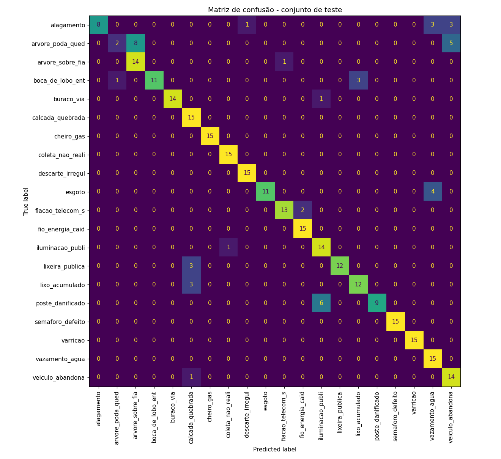

# Resultados da avaliação

> Arquivo gerado por `python avaliar.py`. Todos os números abaixo foram medidos nesta execução, com dados **sintéticos** (ver limites no fim).

## 1. Classificador de categorias (TF-IDF + Regressão Logística)

- Treino: **2400** frases sintéticas (120 por categoria).
- Teste: **300** frases (15 por categoria, 20 categorias), escritas com **modelos de frase diferentes** dos de treino, com erros de digitação, caixa alta e dados pessoais fictícios.
- **Acurácia geral: 84,7%** (254/300 acertos).

| Categoria | Precisão | Recall | F1 | Amostras |
|---|---|---|---|---|
| alagamento | 1.00 | 0.53 | 0.70 | 15 |
| arvore_poda_queda | 0.67 | 0.13 | 0.22 | 15 |
| arvore_sobre_fiacao | 0.64 | 0.93 | 0.76 | 15 |
| boca_de_lobo_entupida | 1.00 | 0.73 | 0.85 | 15 |
| buraco_via | 1.00 | 0.93 | 0.97 | 15 |
| calcada_quebrada | 0.68 | 1.00 | 0.81 | 15 |
| cheiro_gas | 1.00 | 1.00 | 1.00 | 15 |
| coleta_nao_realizada | 0.94 | 1.00 | 0.97 | 15 |
| descarte_irregular | 0.94 | 1.00 | 0.97 | 15 |
| esgoto | 1.00 | 0.73 | 0.85 | 15 |
| fiacao_telecom_solta | 0.93 | 0.87 | 0.90 | 15 |
| fio_energia_caido | 0.88 | 1.00 | 0.94 | 15 |
| iluminacao_publica | 0.67 | 0.93 | 0.78 | 15 |
| lixeira_publica | 1.00 | 0.80 | 0.89 | 15 |
| lixo_acumulado | 0.80 | 0.80 | 0.80 | 15 |
| poste_danificado | 1.00 | 0.60 | 0.75 | 15 |
| semaforo_defeito | 1.00 | 1.00 | 1.00 | 15 |
| varricao | 1.00 | 1.00 | 1.00 | 15 |
| vazamento_agua | 0.68 | 1.00 | 0.81 | 15 |
| veiculo_abandonado | 0.64 | 0.93 | 0.76 | 15 |
| **média (macro)** | **0.87** | **0.85** | **0.83** | 300 |

### Limiar de confiança x % automatizado x acerto

Se o robô só aceitasse a categoria da IA acima do limiar (o resto iria para revisão humana):

| Limiar | % automatizado | Acerto do que foi automatizado | Erros que passariam |
|---|---|---|---|
| 0.00 | 100,0% | 84,7% | 46 |
| 0.30 | 89,7% | 87,4% | 34 |
| 0.40 **(usado)** | 82,7% | 87,9% | 30 |
| 0.50 | 73,7% | 89,1% | 24 |
| 0.60 | 67,0% | 91,0% | 18 |
| 0.70 | 55,0% | 96,4% | 6 |

### Análise dos erros

46 erros. Pares de categorias mais confundidos:

| Par confundido | Erros | Por que confunde |
|---|---|---|
| arvore_poda_queda x arvore_sobre_fiacao | 8 | as duas falam de árvore e galho; só a menção a fio/cabo separa |
| iluminacao_publica x poste_danificado | 6 | ambas citam 'poste' e 'luz' |
| arvore_poda_queda x veiculo_abandonado | 5 | 'galho caiu em cima de um carro': a palavra 'carro' puxa para veículo |
| esgoto x vazamento_agua | 4 | ambas descrevem água escorrendo na rua; o que separa é 'limpa' x 'suja/fedor' |
| boca_de_lobo_entupida x lixo_acumulado | 3 | bueiro 'tampado de lixo' mistura as duas |
| calcada_quebrada x lixo_acumulado | 3 | o lixo está 'na calçada': a palavra calçada pesa demais |
| calcada_quebrada x lixeira_publica | 3 | 'cesto de lixo da calçada amassado' tem vocabulário de calçada |
| alagamento x vazamento_agua | 3 | 'água subiu/entrou nas casas' sem a palavra chuva lembra vazamento |

Exemplos de erros (texto já anonimizado):

| Texto | Esperado | Previsto | Confiança |
|---|---|---|---|
| Meu zap pra contato é [TELEFONE]. Solicito a poda da copa da árvore da fente do 1984, galhos ba | arvore_poda_queda | arvore_sobre_fiacao | 91% |
| Contato: [EMAIL] Tem água preta com cheiro de cocô escorrendo na Rua Augusta. Obrigado. | esgoto | vazamento_agua | 76% |
| Bom dia. A estrutura do poste de luz quebrou e tá escorada no muro. Já reclamei antes e nada. | poste_danificado | iluminacao_publica | 74% |
| bom dia. a estrutura do poste de luz quebrou e ta escorada no muro. isso e um perigo! | poste_danificado | iluminacao_publica | 74% |
| Contato: [EMAIL] Os galhos da árvore estão quebrados e balançando em cima da calçada. | arvore_poda_queda | arvore_sobre_fiacao | 71% |
| Contato: [EMAIL] Tem água preta com cheiro de cocô escorrendo na Rua Cachoeira. Obrigado. | esgoto | vazamento_agua | 71% |
| sou [NOME], cpf [CPF]. a estrutura do poste de luz quebrou e ta escorada no muro. | poste_danificado | iluminacao_publica | 70% |
| sou [NOME], cpf [CPF]. o cesto de lixo da calcada em frente ao 1836 esta todo amassado. | lixeira_publica | calcada_quebrada | 69% |
| A ESTRUTRUA DO POSTE DE LUZ QUEBROU E TÁ ESCORADA NO MURO. | poste_danificado | iluminacao_publica | 69% |
| Sou [NOME], CPF [CPF]. Os galhos da árvore estão quebrados e balançando em cima da calçada. | arvore_poda_queda | arvore_sobre_fiacao | 68% |
| Boa tarde, O fio da operaodra de internet ta caído na frente da mercado, sem energia nenhuma. O | fiacao_telecom_solta | fio_energia_caido | 67% |
| Meu zap pra contato é [CPF]. Os galhos da árvore estão quebrados e balançando em cima da calçad | arvore_poda_queda | arvore_sobre_fiacao | 66% |

Dos 46 erros, **30** tiveram confiança ≥ 40%: são os que o limiar sozinho não segura. No encaminhamento há uma segunda trava: a IA precisa **concordar** com a categoria escolhida pelo cidadão (seção 3).

## 2. Anonimização de dados pessoais

- Dados pessoais fictícios inseridos nos 300 textos de teste: **260** (cpf: 54, email: 51, nome: 103, telefone: 52)
- **Taxa de mascaramento: 100,0%** (260/260)
- Limite conhecido: nome só é detectado depois de gatilhos ("meu nome é", "sou", "me chamo", "aqui é o/a"). Nome solto no meio da frase não é detectado.
- Um número de 11 dígitos sem pontuação (ex.: celular `119...`) é marcado como [CPF] em vez de [TELEFONE]: continua mascarado, só o rótulo fica impreciso.

## 3. Encaminhamento ponta a ponta (RF33) x gabarito

Execução isolada em `avaliacao_execucao/`: **80 ocorrências simuladas** lidas pela **API simulada** (mesmo contrato de `CONTRATOS.md`, seção E), e-mails entregues a um SMTP de teste embutido.

| Grupo do gabarito | Qtde | Resultado do robô |
|---|---|---|
| Válidas com categoria correta (esperado: enviar) | 60 | 40 enviadas, 20 para revisão humana |
| Categoria final errada (esperado: revisão) | 10 | 10 barradas na revisão |
| Dados inválidos (esperado: revisão) | 6 | 6 barradas na revisão |
| Já enviadas antes (esperado: ignorar) | 4 | 4 ignoradas (não vêm na lista de pendentes) |

- **Envios errados (ocorrência enviada que deveria ir para revisão): 0**
- Enviadas para o responsável correto: **40/40**
- Taxa de automação das válidas: **66,7%**; o resto foi para revisão por divergência ou confiança baixa da IA (falso alarme: custa tempo de um atendente, não um envio errado).
- E-mails recebidos pelo SMTP de teste: **40**; status `enviada` gravado via API (PATCH): **40/40**
- Dados pessoais encontrados no texto dos e-mails enviados: **0**
- **Reexecução (idempotência):** 2ª rodada leu 36 pendentes e enviou **0** e-mails.

Motivos da revisão humana: divergência (23), confiança baixa da IA (7), dado inválido (6)

Mesma regra de decisão com outros limiares (válidas + categoria errada; inválidas são barradas pela validação):

| Limiar | Válidas enviadas | Categoria errada enviada (erro grave) |
|---|---|---|
| 0.00 | 47/60 (78,3%) | 0/10 |
| 0.30 | 43/60 (71,7%) | 0/10 |
| 0.40 **(usado)** | 40/60 (66,7%) | 0/10 |
| 0.50 | 35/60 (58,3%) | 0/10 |
| 0.60 | 34/60 (56,7%) | 0/10 |

## 4. Etiquetagem dos trechos raspados (metadado do RAG)

- Base de conhecimento atual: **98 trechos**; 86 com categoria e 12 como `geral` (confiança < 30%).
- Amostra rotulada: **30 trechos** (`data/amostra_docs_rotulada.csv`); encontrados na base atual: 30.
- **Acerto da etiqueta: 83,3%** (25/30).
- Regra de rótulo: a categoria do assunto do trecho no contexto da página; `geral` quando o trecho não trata de nenhuma das 20 categorias.

| Trecho | Rótulo | IA | Confiança |
|---|---|---|---|
| Eletrônico: 1) Faça login no Portal de Atendimento SP156 (você já está aqui), cl | buraco_via | geral | 27% |
| • Assunto pertinente aos contratos dos Serviços Indivisíveis de Limpeza Urbana. | coleta_nao_realizada | varricao | 34% |
| Eletrônico: Portal de Atendimento SP156. Presencial: • Praças de Atendimento das | coleta_nao_realizada | geral | 22% |
| São as próprias instituições que coordenam esses prédios. No caso de escolas, po | geral | iluminacao_publica | 60% |
| Por tratar-se de uma situação de urgência, entre em contato imediatamente com a  | fio_energia_caido | iluminacao_publica | 64% |

> ⚠️ Os rótulos da amostra ainda são um **rascunho** e precisam ser conferidos por uma pessoa.

## Limites desta avaliação

- Todos os textos de cidadão são **sintéticos**, escritos a partir de modelos de frase. Textos reais são mais variados: a acurácia real tende a ser menor e o modelo deve ser retreinado com dados reais anonimizados.
- O conjunto de teste usa modelos de frase diferentes dos de treino, mas o vocabulário de cada categoria é parecido; isso mede generalização de forma limitada.
- A amostra de trechos raspados tem só 30 itens, rotulados por uma pessoa: serve como evidência, não como estimativa estatística precisa.
